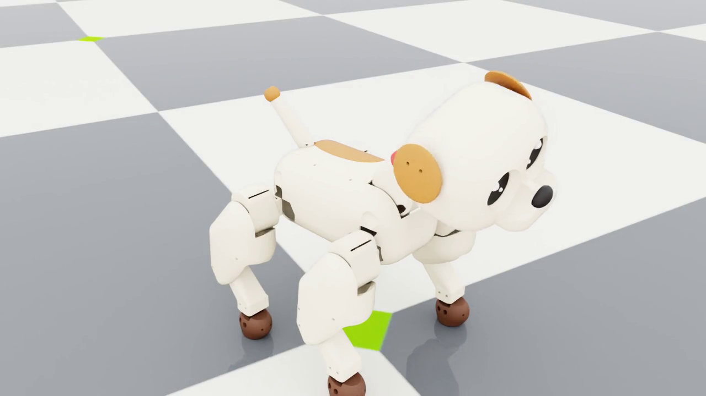
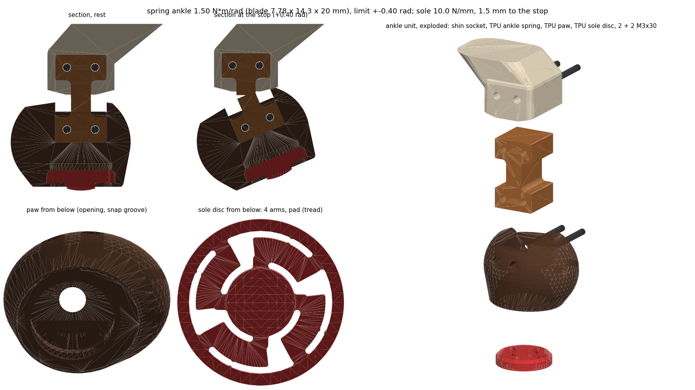

# Puppy: printable robot dog (experiment 2)



A 15-servo robot puppy (Feetech STS3215 bus servos) that can really be printed and built. Every part in `print/stl/`
is a closed solid, laid flat in its print orientation, with servo mounts, screw holes, heat-set insert holes,
bearing seats and cable passages. Generated from `genome.json` by `core/morphology/dog_mech.py`:

```bat
lab -m core.morphology build prototypes\puppy\genome.json --out prototypes\puppy
lab -m core.morphology.dog_check prototypes\puppy\genome.json      :: interference check, all joints through their range
lab -m core.morphology.dog_views prototypes\puppy\genome.json      :: exploded view, parts overview, ankle close-up
lab -m tools.dog.leg_clearance prototypes\puppy\genome.json        :: hip angle where front and rear leg first touch
lab -m tools.dog.ankle_fe prototypes\puppy\genome.json             :: FE check of the ankle spring and the sole spring
```

| | |
|---|---|
| Size | 36 x 25 x 37 cm (nose to tail tip x width x floor to top of the head), chassis centre 19 cm above the floor |
| Mass | 2.45 kg: printed parts 1.19 kg (PLA 1.05 kg, TPU 133 g), 15 servos 825 g, battery 125 g, screws/inserts/bearings ~175 g, electronics + cables ~120 g |
| Servos | 15 x STS3215 12 V (30 kgf·cm), daisy-chained serial bus, ids 1-15 |
| Power | 3S LiPo 1500 mAh in a belly bay (one thumb screw), fuse, switch at the rear; 5 V buck for the electronics |
| Legs | all knees point backwards (owner's choice 2026-10-11, simulation variant D); spring ankles (TPU flexure, 1.5 N·m/rad) and soft paws (TPU sole spring, 10 N/mm), as in the best simulated variants (B, D) |
| Parts | 67 printed parts, all fit a 210 x 210 x 210 mm bed (the Centauri Carbon 2 has 256 mm), no supports |

See `print/BOM.md` for every printed part (mass, size, file, print hint) and every purchased part with where each
screw goes; `images/puppy_parts.png` shows all parts in print orientation and `images/puppy_exploded.png` the assembly.

## How it works

- **Body.** A structural *deck* is the chassis core: the four abduction servos hang in saddles under it (screwed
  through their far case holes), the battery bay walls hang between them, the tail servo sits on a shelf, and the
  electronics stand on nylon standoffs on top. The *cap* (back) and the *bowl* (belly and flanks) are cosmetic
  shells: four M3x20 screws from the belly go up through bowl columns and the deck into inserts in the cap.
- **Legs (x4).** Abduction servo (in the body, shaft along x) → *yoke*, a U-bracket bolted to both of its horns
  (the STS3215 has a passive horn on the back, so the leg hangs on two bearings) → *shoulder* (rounded pad around the
  hip servo + bracket plate + a tongue that reaches through a window in the body and is screwed to the yoke) → hip
  servo (shaft along y) → *thigh*: a hub on the hip horn and a pocket for the knee servo, which lies across the top
  of the thigh → *crank* on the knee horn → *pushrod* → lever on the *shin*. Crank and lever are both 18 mm and the rod
  is parallel to the servo-knee line, so the shin turns exactly like the knee servo (1:1 parallelogram). The shin
  turns on an M3 axle with two 683ZZ bearings in a fork of the thigh. The thigh is three prints: structural part,
  outer cover (over crank and rod), inner cover (over the knee-servo connectors). All four knees point backwards: on
  the rear legs only the shoulder side is mirrored front-to-back, and the knee side (thigh, covers, crank, pushrod,
  shin, knee-servo pocket) is the same part as on the front leg. So the crank points forward and the knee lead runs
  to the hip on every leg. At the bottom of the shin a socket holds the TPU *ankle spring*; the round TPU *paw* hangs
  on it, and a TPU *sole* disc snaps into the paw from below (see the next section).
- **Neck and head.** The nod servo stands in the front of the body (leaning back 30°, on a two-cheek mount on the
  deck); the *neck yoke* grips both its horns and carries the head-tilt horn plate. The tilt servo sits inside the
  head on the *head mount* plate, which also carries the *eye frame* with the two round displays. The neck base is a
  round barrel on the nod axis, so the gap to the back stays an even 2 mm ring when nodding. The head is three prints
  (face with snout, head mount, head back) held by four M3x30 screws from the back of the head.
- **Tail.** Tail servo under the back (shaft up), the tail screws onto its horn.

## Spring ankle and soft paw



Why: six leg variants were trained identically in simulation (journal steps 28-29). Soft paws decide the gait (every
soft-paw variant trots on two paws, every hard-paw variant hops) and a springy ankle decides the energy (a stiff ankle
vibrates: ~55-60 W instead of ~19 W). The best dogs (B, and D with these knees) have a passive pitch spring of
1.5 N·m/rad just above the paw (±0.4 rad, damping 0.03 N·m·s/rad) and a compliant paw contact of 1e4 N/m. The print
now matches that. The design code is `core/morphology/dog_paw.py`, sized from the genome's `ankle` and
`paw_contact_stiffness`; the FE check is `tools/dog/ankle_fe.py`, and its report is `runs/exp2_dog/1_design/puppy_ankle_fe.md`.

**Material.** Polymaker PolyFlex TPU95 (Shore 95A). From the technical data sheet V5.4 (polymaker.com, 2024; ISO 37,
X-Y, 100 % infill specimens): Young's modulus 33.6 ± 0.9 MPa, stress at 100 % strain 11.1 MPa, elongation at break
551 ± 24 %, density 1.20-1.24 g/cm³. The older TDS V4.0 (2018) lists a 100 % modulus of 9.4 MPa, tensile strength
29 MPa and elongation 330 %. Polymaker publishes no flexural modulus, no yield point and no Z-direction values. TPU has
no sharp yield: the curve bends over well before 100 % strain (secant 11 MPa vs. 33.6 MPa initial), so the design keeps
the peak strain at 10 % at the hard stops. That is still near the linear range, and 55x below elongation at break.

**Ankle spring** (`ankle_spring_*`, TPU, solid). An I-profile printed lying on its side, so the bending stress runs
along the printed lines and no layer boundary is pulled open:

| | |
|---|---|
| Blade (the flexure) | t = 7.78 mm (along x) x L = 14.3 mm (z) x w = 20 mm (y), 2 mm root fillets |
| Blocks | 20 x 10 x 20 mm, two M3 holes each (x = ±5.5 mm) |
| Pivot | centre of the blade, 18 mm (1.0 paw radius) above the paw centre: exactly where the simulation's hinge `<L\|R><i>_ja` is |
| Pitch stiffness | beam theory k = E·w·t³/(12·L) = 1.84 N·m/rad; 3D FE of the printed profile: 1.54 (blocks held tight) / 1.46 (held at the ends only) → **1.50 N·m/rad** |
| Roll / yaw / shear | roll 7.1 N·m/rad (4.6x pitch), yaw 2.5 N·m/rad (1.6x), axial 217 N/mm, sideways 40-44 N/mm (FE) |
| Strain at ±0.4 rad | 10 % (FE 9-10 %); in walking (0.1-0.2 rad) 2.5-5 % |
| Stops | the shin socket ends in two faces through the pivot axis, the paw's lips in two more, 0.4 rad lower: at ±0.4 rad the paw lands face-on (TPU on PLA, a soft stop) and the spring is never bent further |
| Retention | top block in a PLA socket (2 x M3x30 into heat-set inserts), bottom block in a pocket of the paw (2 x M3x30 through the paw, nyloc nuts): both blocks are bolted through and cannot slide out. The spring itself is the only link, at 1/55 of its breaking strain at the stops |

Roll is clearly stiffer (4.6x). In yaw the blade is only 1.6x stiffer than in pitch, which is enough: a paw's yaw load is
the friction torque of a ~1 cm² contact patch (~0.02 N·m → < 0.01 rad). A sideways push of 3 N at the sole tilts the
paw by ~1° in roll.

**Soft paw.** A round hollow paw printed sole-down cannot be this soft. It needs a printable flat of r ≥ 6 mm, and a TPU
shell on such a flat is 30-55 N/mm at 1.0-1.6 mm wall (axisymmetric FE; thin-shell theory gives 4-11 N/mm only for a
point contact). So the paw is a housing, and the softness sits in a separate *sole* disc (`sole_*`, TPU, solid,
printed flat). Its rim snaps past a lip into a groove in the paw and presses on a 45° conical seat. Four 55° arc arms
carry a central pad (r = 5.5 mm, domed tread) that sticks out 1.5 mm below the paw's rim. Arms 4.23 mm thick:
**10.0 N/mm** (3D FE: 10.0 with the tread sliding, 10.5 sticking), i.e. 0.6 mm under a standing paw (6 N) and 1.2 mm
at 12 N. After 1.5 mm (15 N) the paw's rim lands on the floor: a progressive bump stop. Peak strain in the arms is
7.8 % at 1 mm and 11.7 % at the stop. The paw keeps its round brown look, toes and TPU grip; the pad is the tread.

**Estimates and uncertainty.**

| | design | sources of error | expected range |
|---|---|---|---|
| Ankle pitch | 1.50 N·m/rad | printed vs. specimen modulus ±15 %, block support ±3 % (FE: 1.46-1.54), t ±0.1 mm → ±4 %, temperature 18-28 °C ±5 %, softening after the first cycles (Mullins) and at large angles (−5 to −15 %), dynamic stiffening at gait rates (+5 to +15 %) | 1.1-1.9 N·m/rad (±25 %) |
| Sole | 10.0 N/mm | modulus ±15 %, mesh/geometry ±5 %, tread sliding vs. sticking +5 %, arm thickness ±0.1 mm → ±5 % | 7.5-12.5 N/mm (±25 %) |

Both springs share the one material constant, so a single measurement of the ankle calibrates the sole too. Print one
leg's set first and measure it (below).

### Tuning the ankle and the sole

The generator sizes both springs from the genome: `ankle.stiffness` sets the blade (t, and L = 1.84·t keeps 10 %
strain at `ankle.limit`), `paw_contact_stiffness` sets the arm thickness. To correct them after a test print:

1. Measure the ankle's k (below) and compute the modulus your printer really gives:
   `E = 33.6 MPa x k_measured / k_design` (k_design = 1.50 N·m/rad for the current spring).
2. Put it in `core/morphology/dog_paw.py` (`TPU_E = ...`) and rebuild
   (`lab -m core.morphology build prototypes\puppy\genome.json --out prototypes\puppy`). The spring and the sole are
   re-sized for the genome's targets, so print and simulation agree again.
3. Or change only the blade thickness by hand: at fixed L, k grows with t³ (one dimension).

| blade t [mm] (L = 14.3) | 7.18 | 7.38 | 7.58 | **7.78** | 7.98 | 8.18 | 8.38 |
|---|---|---|---|---|---|---|---|
| k [N·m/rad] | 1.18 | 1.28 | 1.39 | **1.50** | 1.62 | 1.75 | 1.88 |

| sole arms [mm] | 3.0 | 3.5 | 4.0 | **4.23** | 4.5 | 5.0 |
|---|---|---|---|---|---|---|
| k [N/mm] (k ~ t^2.2) | 4.7 | 6.6 | 8.8 | **10.0** | 11.4 | 14.4 |

The sole disc is a ~20-minute print, so trying three is the quickest route: build copies of the genome with
`paw_contact_stiffness` = 7000 / 10000 / 13000 N/m (arms 3.6 / 4.2 / 4.8 mm) using `--no-usd --out runs\scratch\...`,
print their `sole_front_L.stl`, and keep the best.
If you would rather keep a print that measured differently, put the measured values into the genome
(`ankle.stiffness`, `paw_contact_stiffness`) and retrain instead.

### Test print: what to measure

Print one shin, one ankle spring, one paw and one sole; assemble them (step 8 below). First bend the paw by hand 20
times to the stops: TPU softens a little over the first cycles, and the robot will see the softened spring.

- **Ankle stiffness (lever and weight).** Clamp the shin upright in a vice, paw hanging. Tape a stiff ruler to the
  paw, horizontal and pointing forward, with its 0 mark under the pivot (the middle of the blade, 18 mm above the paw
  centre). Hang a weight at 100 mm and read how far the ruler end at 200 mm drops (caliper or a second ruler).
  θ = drop / 200 mm, M = m·g·0.1 m, k = M / θ. Expected for 1.5 N·m/rad: 50 g → 0.033 rad, 6.5 mm drop;
  100 g → 0.065 rad, 13 mm; 200 g → 0.13 rad, 26 mm. Use the difference between two weights (this cancels the ruler's
  own weight) and load both ways (forward and back). Turned sideways (ruler along y), the ankle should be ~4.5x stiffer.
- **Paw compression.** Stand the paw (with its sole) on a kitchen scale, press the shin straight down, and measure
  the gap between the paw's rim and the scale with feeler gauges (or sheets of 80 g/m² paper, ~0.1 mm each). With
  nothing on it the gap is 1.5 mm. Expected: 1.0 mm gap at 500 g (5 N), 0.5 mm at 1 kg, rim touching at ~1.5 kg. On
  the finished dog standing still, every paw rim should be ~0.8-1.0 mm off the floor.
- **Stops.** By hand the paw swings ±23° and lands softly, face-on, on the shin socket. It must spring back straight
  when let go. If it stays bent, the TPU was printed too cold or too fast (weak layer bonding): reprint hotter.

## Design assumptions (check on a real servo before printing)

Servo geometry is taken from the official Feetech/Waveshare drawing and STEP model of the ST3215/STS3215 ("SCS215",
2022-06-08; 45.22 x 24.72 mm, shaft 10.11 mm from the end, 32 mm over the case pads, 37.25 mm over both horns).
Things I could not see in the drawing and assumed:

1. **Case holes** are 1.6 mm, for **M2 self-tapping screws**, 20.5 mm apart: output face at 8.3 and 32.75 mm from the
   shaft, back (passive-horn) face at 8.3 and 29.0 mm. Brackets are 2.5-4 mm thick; M2x8 needs >= 4 mm of thread in
   the case. Check the depth of the holes.
2. **Horns**: both the output and the passive horn are Ø19.2 aluminium discs with four Ø2.5 holes on a Ø14 circle.
   I assumed they take **M3 screws** (Ø2.5 is the M3 tap drill: if they are not threaded, tap them M3). All horn
   screws are M3x6 through 3.6 mm of plastic; the centre screw head sits in a Ø7.5 hole. The output horn face is
   2.4 mm above the case pad region near the shaft; driven parts keep >= 2 mm clear of the case.
3. **Connectors**: the two 3-pin bus sockets plug in from the **back (passive-horn) face**, 10.5-17.5 mm from the
   shaft. Every bracket leaves an 11 mm deep window there for the plugs and a tight wire bend.
4. **Displays**: GC9A01 1.28" round modules, assumed PCB ≤ 40.4 x 37.5 mm, glass Ø36, total thickness ~4 mm plus
   components/header behind (8 mm keep-out). They sit in the eye frame behind Ø34 openings with a chamfered socket.
   Fix them with 2 x M2 if your module has holes, otherwise a drop of hot glue.
5. **Boards**: the deck has M2.5 insert holes at the corners of each board's outline (bus adapter 40 x 30, buck
   22 x 17, IMU 21 x 16, ESP32-S3 SuperMini 23 x 18). Board hole positions vary between sellers: drill/adjust, or
   use double-sided foam tape (fine for the SuperMini, not for the IMU).
6. **Battery** 3S 1500 mAh, at most 75 x 35 x 26 mm (the bay between the front and rear yokes is 76 mm long).
7. **Print model** for the masses: PLA, 3 perimeters, 5 top/bottom layers, 15 % gyroid; TPU 95A paws, ears and
   collar the same; the TPU ankle springs and sole discs solid (100 %).

## Printer and filament (owner's setup, 2026-10-11)

- Printer: Elegoo Centauri Carbon 2 Combo: enclosed CoreXY, 256 x 256 x 256 mm bed, hardened nozzle, CANVAS 4-color
  unit. The parts were laid out for a 210 mm bed, so they all fit. None was split because of the bed (head, thigh and
  neck are split for assembly), so the larger bed needs no merged parts.
- TPU: Polymaker PolyFlex TPU95 (95A), 1.75 mm. Elegoo's guide: https://wiki.elegoo.com/centauri-carbon-2-combo/how-to-print-tpu
  (TPU bypasses CANVAS through a printable TPU adapter and cannot be mixed with other filaments in one job, so the
  TPU parts - ankle springs, soles, paws, ears, collar - are printed as their own jobs). Adapter: print Elegoo's flexible-filament Y-adapter,
  clip it to the side of the CANVAS, fit the 3 PTFE collets and clips and the 2 PTFE tubes from the accessory pack and
  route channel 1 through it (Elegoo's installation sheet). 20-40 mm/s, little or no
  retraction, dry filament. The owner's shop lists TPU as compatible with this printer; print one leg's ankle set
  (spring, paw, sole) as a test first and measure it (see "Test print").
- Colors: CANVAS can print the visible details (eyes, nose, ear and spot accents, collar) in color in PLA.
- **TPU jobs** (all TPU parts at once fit one 256 mm plate: 4 ankle springs, 4 paws, 4 soles, 2 ears, collar):
  225 °C nozzle, 35-45 °C textured PEI, part fan on, 20-30 mm/s (walls 20 mm/s; Polymaker's range: 210-230 °C, bed
  25-60 °C, 30-50 mm/s), 0.2 mm layers, short slow retraction (~1 mm: the TPU path through the adapter is long),
  filament dried (70 °C, 8 h). **Ankle springs and soles are springs: 100 % infill, 4 walls**, printed as laid out
  (springs on their side, soles flat with the arms on the bed, pad up). Their stiffness was computed for solid TPU;
  sparse infill would make the blade ~20 % softer and less predictable. Paws, ears, collar: 3 walls, 15 % infill;
  paws stand on their rim (sole opening down) and need no support (cavity roof 45°, groove seat 45°).
- **Shins** (PLA) print on their flat outboard face; the ankle socket's inboard cheek bridges 20 mm over the socket.

## Tools and consumables

Soldering iron with a heat-set insert tip (~220 °C), 2.5 mm and 2 mm hex keys, #0/#1 Phillips, a **long** 2.5 mm hex
driver (≥ 80 mm shaft) for the belly screws, M3 tap (only if the horns are not threaded), CA glue, cable ties.

## Assembly order

Do the steps in this order: some screws can only be reached before the next part goes on.

1. **Prepare prints.** Melt in the heat-set inserts (39 x M3x5, of them 2 per shin into the inboard cheek of the ankle
   socket, from the inboard face; 8 short M3x3 in cranks and shin levers; 8 x M2.5 in the deck). Press a 683ZZ bearing into each pushrod eye and into both ends of each shin's knee boss.
2. **Program the servos** one at a time on the bus adapter: set the id (table below) and centre each servo
   (position 2048). Label them. Do all mechanical zeroing at the centre position.
3. **Deck sub-assembly** (deck upside down on the table):
   - For each abduction servo: slide it into its *yoke* (both horns against the arms), 8 x M3x6 into the horns.
     Push servo + yoke up into the deck saddle and fix with 4 x M2x8 through the saddle plates.
   - Tail servo into its shelf (4 x M2x8 from below). Battery cable, fuse holder and switch leads through the
     middle hole. Run each abduction servo's lead up through the slot next to it.
   - Turn the deck over: neck servo + *neck yoke* (8 x M3x6 into both horns; slide the servo into the yoke first),
     then the *neck mount* cheeks (4 x M2x8) and the mount onto the deck (2 x M3x8).
   - Electronics on standoffs: bus adapter, buck converter, IMU (flat, arrow forward), ESP32 (tape or standoffs).
4. **Cap**: put the cap over the deck and hold it there.
5. **Bowl**: lower the deck + cap into the bowl (the yokes sit just inside the shoulder windows). Four M3x20 from the
   belly through the bowl columns and the deck into the cap inserts (long hex driver). Fit the USB-C extension and the
   rocker switch in the rear wall.
6. **Shoulders**: push each *shoulder* tongue through its body window onto the yoke flange; 2 x M3x8 from inside the
   tongue channel. Mount the hip servo (servo lead pushed through the plate window into the channel) with 4 x M2x8
   from the inside of the shoulder plate.
7. **Thighs**:
   - Knee servo into the *thigh* pocket from the inside, 4 x M2x8 from the outside (heads in counterbores).
   - *Crank* on the knee horn (4 x M3x6), lever pointing forward. *Pushrod* onto the crank pin (M3x8 button head +
     washers into the crank insert).
   - Hang the *shin* in the knee fork, pushrod onto the lever pin, then the spacer tube and the M3x45 axle with a
     nyloc nut in the hex pocket of the fork (snug, the shin must swing freely). Check: at servo centre the crank and
     lever are parallel and the leg is in the rest pose; if not, re-index the horn spline (14.4° steps) and trim the
     rest with the servo's position offset.
   - Thigh hub onto the hip horn: 4 x M3x6 from the outside (before the outer cover goes on).
   - Knee servo lead out through the hole in the *inner cover* towards the hip; inner cover on with 2 x M2x8 into the
     knee servo's back face. *Outer cover* with 2 x M3x20 countersunk.
   - Lead the knee servo cable in a loose loop past the hip into the shoulder and on into the body.
8. **Ankles and paws** (each leg; the spring is the same for all four, paws and soles are left/right mirror images):
   - Bend the ankle spring by hand 20 times (±25°).
   - Push its lower block into the paw's pocket, blade upright. Two M3x30 go from the outboard counterbores through
     the paw and the block; the nyloc nuts sit in the inboard hex recesses. Tighten only until snug (TPU).
   - Snap the sole into the paw's bottom opening: flat face (with the arms) first, pad pointing down. Tilt it, hook
     one edge under the lip, then press round until the rim clicks onto its seat. The pad sticks out 1.5 mm.
   - Push the spring's upper block up into the shin socket until it bottoms. Two M3x30 go from the outboard side
     through the cheek and the block into the inserts. Snug.
   - Check: the paw hangs straight, swings ±23° by hand to the soft stops and springs back. To take a paw off, undo
     the two upper screws.
9. **Head**: ears onto the *face* first (2 x M3x12 + nyloc nut each, nuts from inside). Tilt servo onto the
   *head mount* (4 x M2x8), displays into the *eye frame*, eye frame onto the mount (2 x M3x10). Neck-yoke stem plate onto the tilt horn (4 x M3x6 through the access holes in the stem). Feed the
   tilt servo and display wires through the mount slot and down the stem channel. Fit the *face*, then the *head back*
   over the stem; 4 x M3x30 from the back. Glue the nose into its pocket.
10. **Neck shell**: the two halves around the yoke, TPU *collar* stretched into the groove (it holds the halves
    together), 2 x M3x10 under the collar into the yoke. Glue the tag.
11. **Tail** onto the tail horn (4 x M3x6), glue the tip ball on.
12. **Battery**: in through the belly, strap, hatch: tongue under the front edge, thumb screw at the back.

## Servo ids and wiring

| Bus id | Joint | Position | Direction | Range |
|---|---|---|---|---|
| 1 | `L0_j0` | front L abduction | +1 | ±29° |
| 2 | `L0_j1` | front L hip | +1 | ±69° |
| 3 | `L0_j2` | front L knee | +1 | ±57° |
| 4 | `R0_j0` | front R abduction | -1 | ±29° |
| 5 | `R0_j1` | front R hip | -1 | ±69° |
| 6 | `R0_j2` | front R knee | -1 | ±57° |
| 7 | `L1_j0` | rear L abduction | -1 | ±29° |
| 8 | `L1_j1` | rear L hip | +1 | ±69° |
| 9 | `L1_j2` | rear L knee | +1 | ±57° |
| 10 | `R1_j0` | rear R abduction | +1 | ±29° |
| 11 | `R1_j1` | rear R hip | -1 | ±69° |
| 12 | `R1_j2` | rear R knee | -1 | ±57° |
| 13 | `neck_j0` | neck nod | +1 | ±34° |
| 14 | `head_j1` | head tilt | +1 | ±29° |
| 15 | `tail_j0` | tail wag | +1 | ±46° |

Direction is the sign that turns a positive joint angle (simulation convention) into the servo's own positive
direction; `print/servo_map.json` has the same table for the firmware (centre 2048 ticks, 651.9 ticks/rad). The rear
abduction servos face backwards, so their signs differ from the front ones.

- **Bus**: every servo has two sockets, so each leg is a chain: adapter → abduction → hip → knee. Six chains from
  the bus adapter (use a 6-way 3-pin splitter if your adapter has fewer ports): four legs, neck → head tilt
  (through the neck), tail.
- **Power**: battery → XT30 → 7.5 A fuse → rocker switch → bus adapter power input (12.6 V max, the 12 V servos run
  directly from 3S) and → buck converter (5 V) → ESP32 5 V pin. Displays and IMU from the ESP32's 3.3 V.
- **ESP32-S3**: UART TX/RX to the bus adapter (adapter in UART mode), I2C (SDA/SCL) to the IMU, SPI to the displays
  (shared SCK, MOSI, DC, RST; one CS each). Display and tilt-servo wires run through the head mount slot, the neck
  yoke stem and the neck into the body; leave a slack loop for nodding and tilting.

## Mechanical limits (from the interference check)

`interference_check.txt` sweeps every joint through its full simulated range against all other parts (the ankle spring
is checked as two rigid halves split at its pivot), plus the hip angles where the legs first touch
(`tools/dog/leg_clearance.py`):

- Rest pose, abduction (±29°), knee (±57°), ankle (±23°, the stops land exactly at the limit), neck (±34°), head tilt
  (±29°) and tail (±46°): no contact. The knee-side parts of the backward rear knees clear the shoulder pad, the body
  and the tail through the full hip range; the knee cables still leave each knee servo towards the hip, and the
  pushrod parallelogram works the same way (servo directions unchanged, see the table above).
- Hip (±69°) only touches the **other leg on the same side**:

| first contact | all knees back (now) | front knee back, rear forward (fallback) | before the ankle (rigid paws) |
|---|---|---|---|
| front hip swings back, rear leg at rest | 64° (paw x rear thigh) | 46° (paw x rear shin) | 45° |
| rear hip swings forward, front leg at rest | 42° (front shin x rear paw) | 42° | 45° |
| both swing towards each other | 24° each (paw x paw) | 24° each | 25° each |

  The backward rear knees give the front leg more room; otherwise the paws (47 mm long, 160 mm apart) set the limit.
  Trot-like gaits stay inside that. The simulator does not model self-collision, so a firmware limit or a training
  penalty is advisable.
- The shoulder pads tuck into scoops in the body when the leg abducts; all moving gaps are ≥ 2 mm (no finger traps
  in the shells; the knee crank and pushrod run fully enclosed in the thigh).

## Simulation model

The simulator gets the real thing: link masses come from the printed solids (skins + infill; the TPU springs solid),
the servos (55 g each, where the case really sits, plus 5 g of lead), electronics, battery, screws, inserts and bearings
on the link that carries them. Collision shapes are boxes/capsules/spheres around the outer shells (body and head as
three boxes each, shin capsule down to the ankle socket, one paw sphere of r = 18 mm per paw). Joint names, axes and
ranges are unchanged; joint origins sit where the real mechanism turns (abduction axis 33.5 mm off centre and 14 mm
above the hip axis, knee axle where it really is). The crank and pushrod are counted on the thigh.

Spring ankles (genome `ankle.enabled = true`): the paw, its sole, the lower half of the ankle spring and the two paw
bolts form link `<L|R><i>_s3` (26 g) on the passive hinge `<L|R><i>_ja` (pitch, ±0.4 rad) at the spring's pivot.
The shin link `_s2` (35 g) carries the upper half of the spring and the socket bolts. Before this change the paw was
13 g and the shin 27 g. The spring constant, damping and limit come from the genome (`ankle`); the paw contact is
PhysX compliant contact (`paw_contact_stiffness = 1e4 N/m`, `paw_contact_damping = 100 N·s/m`). The geometry is
generated from the same genome values, so print and simulation agree by construction.

Damping is the one thing the print does not reproduce. TPU's loss factor (~0.05-0.1) makes the real ankle and sole
much less damped than the simulation's 0.03 N·m·s/rad and 100 N·s/m, which are over-critical for a 26 g paw on these
springs. The unloaded paw rings at ~55 Hz (lightly damped), which a 200 Hz physics step cannot resolve. The values
B was trained with are kept; randomizing them in training (ankle 0.005-0.03, paw 10-100) would cover the real dog.

## Images

- `images/puppy_front.png`, `images/puppy_side.png`: Isaac Sim renders after 3 s of standing (spring ankles, soft paws)
- `images/puppy_ankle.png`: the ankle spring and soft paw (sections at rest and at the stop, exploded, sole)
- `images/puppy_before_after.png`: rigid paws (before) next to the spring ankles and soft paws
- `images/puppy_exploded.png`, `images/puppy_parts.png`, `preview.png`
